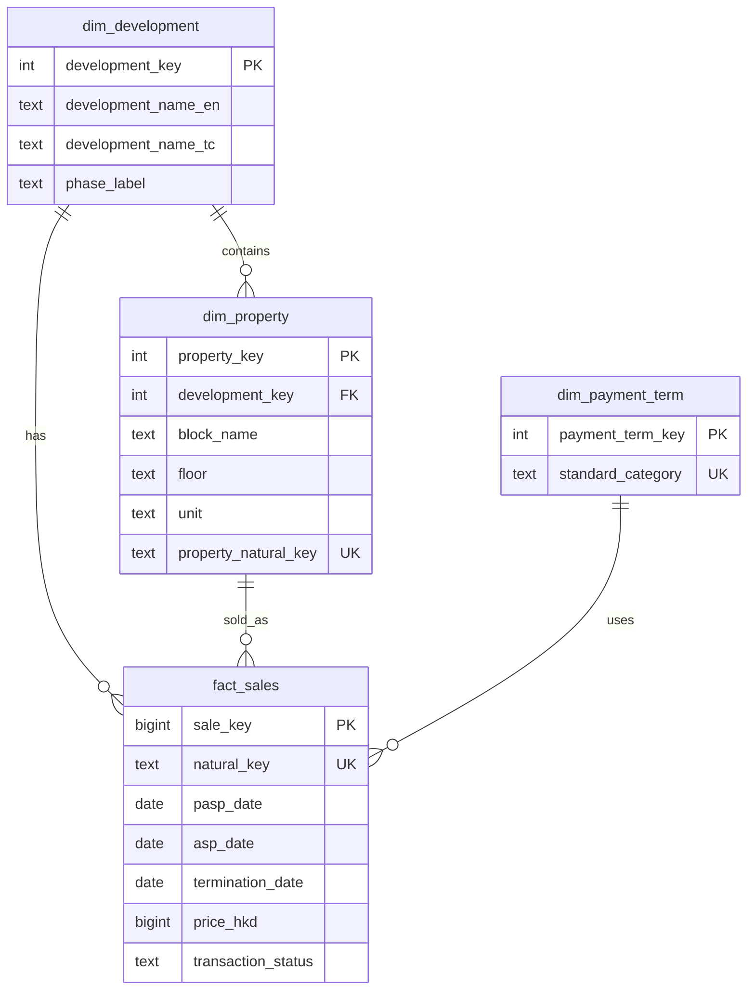

# SRPE Residential Sales ETL Pipeline

[](requirements.txt)
[](load/schema.sql)
[](LICENSE)

End-to-end **ETL pipeline** for **Hong Kong SRPE** (一手住宅物業銷售資訊網) Register of Transactions PDFs — built for **proptech / real estate analytics** portfolios.

> **v1** — Extract → Transform → Load  
> **v2** — Excel + Power Query dashboard on PostgreSQL views

**Live demo data:** THE PAVILIA FARM III (柏傲莊 III) — **706-page PDF**, **1,145 transactions**

---

## Why this project?

Hong Kong pre-sale residential transaction data is published as **large bilingual PDFs** per development — messy, amended over time, and hard to analyse at scale.

This project automates the full data path:

| Challenge | Solution |
|-----------|----------|
| PDFs instead of APIs | `pdfplumber` table extraction + bilingual column parsing |
| Amendments & 撻訂 (terminations) | Idempotent **UPSERT** on `natural_key` |
| Mixed 中文 / English payment terms | Regex-based `payment_mapper` → `standard_category` |
| Repeat ingestion | **SQLite ingestion log** (file hash, page count, status) |
| Reporting for business users | SQL views → **Excel Power Query** live-refresh dashboard |

**Portfolio angle:** Demonstrates the **Data Analyst → Data Engineer** path — from messy public property data to a queryable warehouse and KPI dashboard.

---

## Architecture

```
SRPE Website / Local PDF
        │
        ▼
┌─────────────────┐
│  Extract        │  pdfplumber + Playwright + SQLite ingestion log
│  run_extract.py │
└────────┬────────┘
         │  staging CSV
         ▼
┌─────────────────┐
│  Transform      │  Pandas — dates, HKD prices, payment mapping, natural keys
│  run_transform.py
└────────┬────────┘
         │  clean CSV
         ▼
┌─────────────────┐
│  Load           │  PostgreSQL star schema + UPSERT
│  run_load.py    │
└────────┬────────┘
         │
         ▼
   PostgreSQL (srpe_etl)
   dim_development │ dim_property │ dim_payment_term │ fact_sales
         │
         ▼
   SQL views ──► Excel Power Query (vw_sales_detail)
```

---

## Star schema



**Natural key:** `development|block|floor|unit|pasp_date` — supports safe re-load when SRPE amends prices or records 撻訂.

**Transaction status values:** `asp_signed` · `terminated` · `pasp_only`

---

## Tech stack

| Layer | Tools |
|-------|-------|
| Extract | Python, pdfplumber, Playwright, httpx, SQLite |
| Transform | pandas, bilingual payment mapper |
| Load | PostgreSQL 18, psycopg3, star schema, UPSERT |
| Visualize | Excel Power Query, SQL views, pivot dashboard |
| Config | YAML (`config/settings.yaml`), `.env` (secrets) |

---

## Project structure

```
├── run_extract.py              # CLI: local PDF or SRPE download
├── run_transform.py            # Clean staging → transformed CSV
├── run_load.py                 # Init DB / schema / views / UPSERT load
├── extract/                    # PDF parser, SRPE client, ingestion log
├── transform/                  # Cleaners, bilingual payment mapper
├── load/
│   ├── schema.sql              # Star schema DDL
│   ├── views.sql               # Reporting views
│   ├── sample_queries.sql      # Portfolio analytics examples
│   └── loader.py
├── config/settings.yaml
└── visualize/
    ├── power_query_sales_detail.m
    └── README.md               # Dashboard screenshot instructions
```

---

## Quick start

### 1. Prerequisites

- Python 3.11+
- PostgreSQL 14+ (tested on PostgreSQL 18)
- Playwright browsers (for SRPE download mode only)

### 2. Install

```powershell
git clone https://github.com/Rickylam0303/srpe-etl-pipeline.git
cd srpe-etl-pipeline
python -m venv .venv
.\.venv\Scripts\pip install -r requirements.txt
.\.venv\Scripts\playwright install chromium
```

### 3. Configure database

```powershell
copy .env.example .env
# Edit .env — set SRPE_DB_PASSWORD
```

```powershell
.\.venv\Scripts\python run_load.py --create-db --init-db --init-views
.\.venv\Scripts\python run_load.py
```

### 4. Run the pipeline

**Option A — local PDF (no network scrape):**

```powershell
.\.venv\Scripts\python run_extract.py local --pdf "path\to\64048260626081RT.pdf"
.\.venv\Scripts\python run_transform.py
.\.venv\Scripts\python run_load.py
```

**Option B — download from SRPE:**

```powershell
.\.venv\Scripts\python run_extract.py srpe --dev-id 7705
.\.venv\Scripts\python run_transform.py
.\.venv\Scripts\python run_load.py
```

### 5. Sample SQL

See [`load/sample_queries.sql`](load/sample_queries.sql) for ready-to-run analytics queries (status mix, monthly volume, block pricing, payment mix).

---

## Dashboard (v2)

Live **Excel** dashboard connected to PostgreSQL via **Power Query** on `vw_sales_detail`.

> **Screenshot:** Export your dashboard as `visualize/dashboard.png` (see [`visualize/README.md`](visualize/README.md)). A working pivot setup is enough for portfolio review.

### KPI snapshot — THE PAVILIA FARM III

| KPI | Value |
|-----|-------|
| Total transactions | 1,145 |
| ASP signed | 654 |
| Terminated (撻訂) | 483 |
| PASP only | 8 |
| **Termination rate** | **~42%** |
| Avg price (HKD) | ~$15.5M |
| Payment: Cash plan | 763 |
| Payment: Stage payment | 375 |

### Charts in the dashboard

- Monthly transaction volume (`pasp_month`)
- Average price by block (`block_name` × `final_price_hkd`)
- Payment method mix (`payment_category`)

### Connect Excel to PostgreSQL

1. Install the **Npgsql** provider (required on Windows for Excel's PostgreSQL connector).
2. **Data → Get Data → From PostgreSQL database**
3. Server: `127.0.0.1` · Database: `srpe_etl` · User: `postgres`
4. Load `vw_sales_detail` as a **Table** (not connection-only), then build pivot tables.

Power Query M starter: [`visualize/power_query_sales_detail.m`](visualize/power_query_sales_detail.m)

---

## Key insights (proptech)

From THE PAVILIA FARM III dashboard analysis:

1. **High termination rate (~42%)** — nearly half of recorded transactions ended in 撻訂; launch-period sales volume peaked before tapering, typical of hot new-development cycles in HK.
2. **Tower-level price dispersion** — **Tower 8 (8A)** shows the highest average transacted price (~**HK$18.1M**), useful for block-level pricing and inventory strategy.
3. **Payment mix skew** — cash-plan transactions dominate over stage-payment plans; relevant for developer cash-flow and mortgage-risk reporting.

These are the kinds of metrics property research, agency data teams, and developer sales offices track from SRPE registers.

---

## SQL views

| View | Purpose |
|------|---------|
| `vw_sales_detail` | Denormalized transaction grain for Power Query / BI |
| `vw_monthly_sales` | Monthly volume, termination rate, avg price |
| `vw_block_summary` | Per-block transaction and pricing metrics |

---

## Design decisions

1. **One PDF per development** — matches SRPE publishing model; pipeline is development-scoped.
2. **UPSERT on `natural_key`** — handles price revisions and 撻訂 without duplicate rows.
3. **Bilingual payment mapping** — regex rules map 中文 / English terms to a single `standard_category`.
4. **SQLite ingestion log** — lightweight audit trail (hash, page count, status); mirrors in-house ingestion workflows.
5. **Secrets outside repo** — credentials in `.env`, never committed.


---

## License

MIT — see [LICENSE](LICENSE).

---

## Author

**LAM Wai Kit (Ricky)**

- GitHub: [Rickylam0303](https://github.com/Rickylam0303)
- Email: rickylam0303@gmail.com

Data source: [SRPE](https://www.srpe.gov.hk) (public government data).
