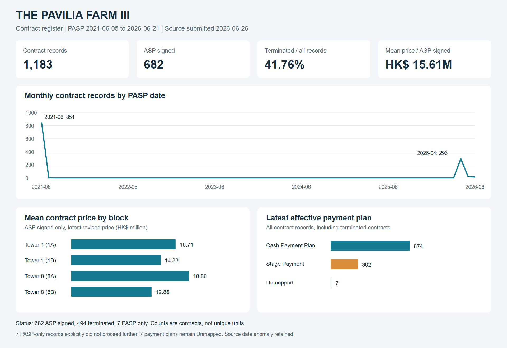

# SRPE Residential Sales ETL Pipeline

Python ETL for Hong Kong first-hand residential **Register of Transactions** PDFs.
The project turns bilingual contract records and amendments into a PostgreSQL
star schema, SQL reports, and an Excel Power Query dashboard.

It demonstrates PDF extraction, source reconciliation, dated amendment handling,
data-quality reporting, relational modeling, UPSERT loading and descriptive analysis.



The image is reproducibly rendered from the checked clean CSV by
`python -m visualize.report --png`. It is a reference report, not a screenshot
of an Excel refresh. Excel connection and chart instructions are in
[visualize/README.md](visualize/README.md).

## Architecture and record grain

```text
SRPE website / local PDF
  -> Extract: pdfplumber + optional Playwright/httpx download
     -> staging CSV + page reconciliation JSON + SQLite ingestion state
  -> Transform: pandas + validation + latest dated price/payment amendments
     -> clean CSV + quality JSON (rejections and source warnings)
  -> Load: PostgreSQL UPSERT
     -> dim_development, dim_property, dim_payment_term, fact_sales
  -> SQL views -> Excel Power Query / reference report
```

One fact row represents one **contract record**, identified by
`development|block|floor|unit|pasp_date`. A unit resold under a different PASP
date has another record. Counts are neither unique units nor completed sales.
See [schema](load/schema.sql) and [reporting views](load/views.sql).

Unchanged identities support price, payment and termination updates. Corrections
to an identity field create a different key and require reconciliation; the
loader does not automatically delete missing source rows or retain every prior
source version. SQLite records the latest ingestion state, not an append-only
history. The supported parser layout is the eleven-column bilingual SRPE format
covered by the fixture; unrelated layouts must be validated separately.

## Reproduce a small example without the website

Prerequisites: **Python 3.12+**, PostgreSQL for the Load step. Tested on Windows,
Python **3.13.13** and PostgreSQL **18.4**. Other Python/OS/PostgreSQL combinations
have not been verified. The locked NumPy version requires Python 3.12+.

```powershell
git clone https://github.com/Rickylam0303/srpe-etl-pipeline.git
cd srpe-etl-pipeline
python -m venv .venv
.\.venv\Scripts\python -m pip install -r requirements-lock.txt
.\.venv\Scripts\python -m pip check
.\.venv\Scripts\python -m unittest discover -s tests -v
```

The bundled [source-page fixture](tests/fixtures/README.md) contains **15 contract
records** and covers the defects found during review. It needs no browser or
network access. Use the demo config to keep these files separate from full data:

```powershell
.\.venv\Scripts\python run_extract.py --config config/demo.yaml local --pdf tests/fixtures/srpe_sample.pdf
.\.venv\Scripts\python run_transform.py --config config/demo.yaml
```

Expected: **15 input and 15 clean rows**, zero errors, two warnings: one source
date contradiction and one explicit PASP-not-proceeded statement. Reports are
written beside staging and clean files under `data/demo/`.

For PostgreSQL, start the local server, then configure credentials:

```powershell
Copy-Item .env.example .env
# Edit .env: set SRPE_DB_USER and SRPE_DB_PASSWORD.
# Use a separate demo database. DATABASE_URL, if set, overrides these fields.
$env:SRPE_DB_NAME = 'srpe_etl_demo'
.\.venv\Scripts\python run_load.py --config config/demo.yaml --create-db --init-db --init-views
.\.venv\Scripts\python run_load.py --config config/demo.yaml
```

The first command initializes and loads; repeating Load should report **0
inserted, 15 updated**, with 15 database records. `--create-db` needs a role with
database-creation permission; otherwise ask the database administrator to
create the target database and omit that flag. Credentials stay in `.env`.

## Reproduce the full reviewed snapshot

The [source manifest](docs/source_snapshot.json) identifies:

- Development: **THE PAVILIA FARM III**, SRPE development ID **7705**.
- File: `64048260626081RT.pdf`, **706 pages**, **3,427,799 bytes**.
- SRPE submission: **2026-06-26 18:53:25 +08:00**.
- SHA-256: `06bb7fe8fda1f6eb66ecda650e63a3cdaf2a619dd9d4141daf891fdfd903216a`.

Open the [SRPE development page](https://www.srpe.gov.hk/opip/selected_dev?devId=7705)
and retrieve this Register of Transactions version if it is still available.
The full historical PDF is not bundled, and SRPE may only expose a newer version.
The fixture provides a deterministic offline example when the historical file
cannot be obtained. **A newer PDF must not be expected to reproduce these KPIs.**

```powershell
Get-FileHash data/raw/pdfs/64048260626081RT.pdf -Algorithm SHA256
.\.venv\Scripts\python run_extract.py local --pdf data/raw/pdfs/64048260626081RT.pdf
.\.venv\Scripts\python run_transform.py
$env:SRPE_DB_NAME = 'srpe_etl'
.\.venv\Scripts\python run_load.py --create-db --init-db --init-views
.\.venv\Scripts\python -m visualize.report
```

To fetch the website's **current** version instead:

```powershell
.\.venv\Scripts\python -m playwright install chromium
.\.venv\Scripts\python run_extract.py srpe --dev-id 7705
.\.venv\Scripts\python run_transform.py
.\.venv\Scripts\python run_load.py
```

Live download depends on SRPE's session, API and page layout. It has not been
revalidated against the live website in this revision. Local PDF processing is
the verified reproduction path. Paths are relative to the repository root;
environment variables override YAML database settings and `DATABASE_URL`
overrides the individual connection fields.

## Quality controls and amendment policy

- Extract reconciles recognizable PASP dates in the first column against parsed
  rows on each transaction page. Missing-bottom-border tables use their actual
  column rules. Explicitly struck-out dates are excluded using PDF geometry.
- Unresolved page counts, duplicate identities, unknown development names and
  zero-transaction documents fail extraction before publishing staging CSVs.
- Identifiers are read as text. Missing identities, malformed dates, nonpositive
  prices, duplicate keys and unresolved/conflicting amendments reject the batch.
- The latest **dated** price and payment amendment wins, regardless of text
  order. Unknown amendment dates are errors. Full payment history and the source
  PDF/page remain available for inspection.
- Source date contradictions are retained and reported. Unmapped payment plans
  are visible warnings. An explicit “PASP has not proceeded further” is kept as
  `pasp_only`, with a warning; it is **not** described as a pending sale.
- A failed Transform writes its report and leaves the last clean CSV unchanged.
  Load blocks failed/stale companion reports and validates identities, dates,
  prices and derived statuses before writing. Process failures exit nonzero.
- Remote version metadata survives parsing. A changed remote version or local
  file hash triggers download; absent comparable remote metadata triggers a
  conservative refresh. Parsing failures are not marked as successful ingestion.

Reports: `data/staging/*_extraction_quality.json` and
`data/transformed/*_transactions_clean.quality.json`. Inspect the status and
individual issues, rather than treating a successful process as a full source
audit. Page reconciliation does not prove every field is correct.

## Checked snapshot results and interpretation

| Metric | Corrected value |
|---|---:|
| Contract records | 1,183 |
| Unique property identities | 857 |
| ASP signed | 682 |
| Terminated | 494 |
| PASP only, explicitly not proceeded | 7 |
| Terminated / all contract records | 41.76% |
| Mean latest contract price, ASP signed only | HK$15,612,120.41 |
| Latest Cash Payment Plan | 874 |
| Latest Stage Payment | 302 |
| Unmapped payment plans | 7 |

PASP dates run from **2021-06-05 to 2026-06-21**. Monthly reports include zero-volume
months and keep years separate. The 2021-06 cohort has **851** records; 2026-06
has **14**. Termination rates describe the current status of PASP cohorts in
this snapshot, not termination events occurring in that month.

Tower 8 (8A) has the highest ASP-signed mean contract price, **HK$18.86M**.
This is an unadjusted descriptive comparison; unit size, floor and layout are
not controlled. It does not establish a tower premium or pricing strategy.
Cash Payment Plan is a payment-plan label, not evidence that a buyer had no
mortgage. No market-cycle, cash-flow or mortgage-risk conclusions are inferred.

The correction recovers **38** omitted records and excludes one superseded ASP
date, changing a previously misclassified status. The
[payment amendment audit](docs/payment_revision_audit.csv) checks **121**
initial-to-latest category changes, including **all 84** previously identified
changes in the old extract. These are automated row-level source-label checks;
selected examples were also visually inspected. There are **15 warnings**:
seven not-proceeded statements, seven unmapped plans and one contradictory date.

Machine-readable results: [snapshot summary](docs/snapshot_summary.json).
Validation evidence and limitations: [validation report](docs/VALIDATION.md).

## Tests and reports

Offline tests run from a fresh clone with the bundled fixture. Database tests
are opt-in and create a UUID-named `srpe_test_*` database, test load/reload,
same-key amendments, zero-month reporting and all six SQL examples, then remove
only that test database. The role needs `CREATEDB` permission.

```powershell
$env:SRPE_RUN_DB_TESTS = '1'
.\.venv\Scripts\python -m unittest discover -s tests -v
# Optional full-snapshot integration test after Extract and Transform:
$env:SRPE_TEST_FULL_CSV = 'data/transformed/THE_PAVILIA_FARM_III_transactions_clean.csv'
.\.venv\Scripts\python -m unittest discover -s tests -p test_postgres.py -v
```

Run [sample queries](load/sample_queries.sql) after initializing views. Both
`vw_monthly_sales` and `vw_block_summary` use **ASP-signed-only** prices. All
contract statuses remain available in `vw_sales_detail`.

To rebuild the reference image from the reviewed full snapshot:

```powershell
.\.venv\Scripts\python -m playwright install chromium
.\.venv\Scripts\python -m visualize.report --png
```

`visualize.report` verifies the source hash and companion reports before
generating summary JSON, the payment audit and SVG/PNG. It intentionally refuses
other source versions. Full data and local workbooks are ignored by Git.

## Author and license

LAM Wai Kit (Ricky) — [Rickylam0303](https://github.com/Rickylam0303)

Code: [MIT](LICENSE). Source material: [SRPE](https://www.srpe.gov.hk), with
original ownership retained. Fixture provenance is documented separately.
