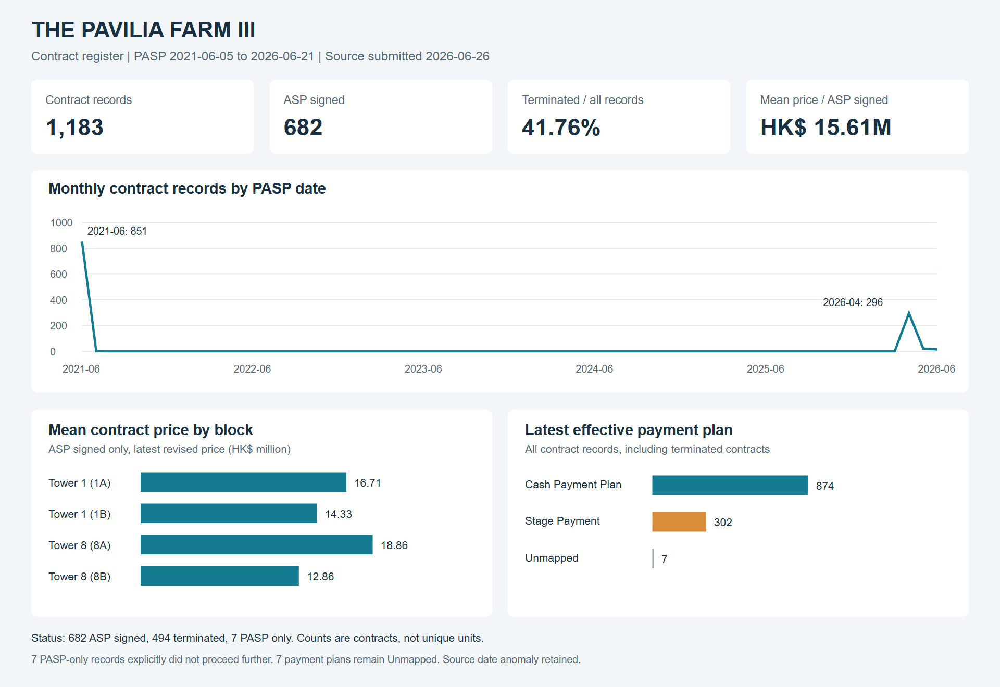

# SRPE Residential Sales ETL

**Python · pandas · pdfplumber · PostgreSQL · SQL · Excel Power Query**

[Code and reproduction](../README.md) · [Validation evidence](VALIDATION.md)

## Problem and deliverable

Hong Kong residential transaction registers contain bilingual tables, revised
prices and payment terms that are difficult to analyze directly. This project
converts one development's historical PDF into traceable contract records,
a PostgreSQL star schema and descriptive reports. The reviewed snapshot covers
THE PAVILIA FARM III, with PASP dates from June 2021 through June 2026.

```text
PDF / SRPE download → staging CSV + page checks → validated clean CSV
                   → PostgreSQL UPSERT → SQL views → Excel / reference dashboard
```

## Work demonstrated

- **Reliable extraction:** Recovered 38 omitted records by handling tables
  with missing bottom borders. Reconciled candidate and extracted counts by
  page, retained source pages and SHA-256, and blocked unresolved batches.
- **Amendment handling:** Selected the latest dated payment and price
  amendments while retaining raw text. Checked 121 payment-category changes,
  including all 84 previously identified differences, against source labels.
- **Database loading:** Used a contract natural key and PostgreSQL UPSERT to
  support repeat loads and same-key revisions. Tested amendments and reloads
  in an isolated database before updating the display data.
- **Reporting:** Created six SQL examples and continuous monthly reporting
  across 61 months, including zero-transaction periods. Defined prices using
  ASP-signed contracts and counts using all contract records.



## Results and evidence

The reconciled snapshot contains **1,183 contract records**, representing
**857 properties**: 682 ASP signed, 494 terminated and seven explicitly not
proceeded further. The termination share is **41.76%** of all records; the mean
latest price among ASP-signed contracts is **HK$15.61 million**.

**Eight tests passed**, covering seven offline regressions and one PostgreSQL
integration test. All six SQL examples executed successfully. Installation
from locked dependencies was tested in a clean environment, and the local
Excel workbook was refreshed from PostgreSQL. A bundled 15-record PDF fixture
supports offline reproduction. The image above is a generated reference
report; it is not an Excel screenshot.

## Scope and limitations

This is a portfolio-scale descriptive pipeline for the tested PDF layout.
Fifteen source/classification warnings remain visible. Contract counts are
not completed sales, and block averages do not establish pricing premiums.
Current live SRPE availability was not reverified. Identity-field corrections
and source deletions need separate reconciliation; the loader handles
amendments with unchanged keys. See the validation record before interpreting
the results or adapting the parser to another register.
